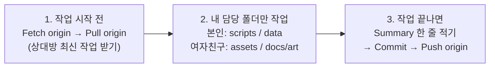

# 커플 2인 GitHub & GitHub Desktop 5분 공유 매뉴얼

코딩이나 터미널 명령어를 단 한 줄도 칠 필요 없이, **버튼 클릭만으로** 오늘 만든 모든 문서와 게임을 비공개(Private) 깃허브에 올리고 여자친구와 팀원처럼 공유하는 방법입니다.

---

## 1단계. 본인: GitHub에 프로젝트 올리기 (3분 컷)

1. **GitHub 가입 & GitHub Desktop 무료 설치:**
   - https://github.com 에서 무료 회원가입 (구글 계정 연동 가능)
   - https://desktop.github.com 에서 **GitHub Desktop** 설치 후 로그인
2. **오늘 만든 폴더 불러오기:**
   - GitHub Desktop 상단 메뉴 **`File` → `Add local repository...`** 클릭
   - `Choose...` 클릭 후 아래 폴더 선택:
     ```text
     C:\Users\u34h81\.gemini\antigravity\scratch\couple-steam-game
     ```
   - *"This directory does not appear to be a Git repository"* 안내가 뜨면 파란 글씨 **`create a repository`** 클릭!
   - 팝업 창에서 `Name`은 그대로(`couple-steam-game`), `Git Ignore`는 **`None`**(이미 우리가 Godot 4 전용 `.gitignore`를 만들어 두었습니다!) 선택 후 **`Create Repository`** 클릭!
3. **비공개(Private)로 GitHub에 업로드:**
   - 상단의 **`Publish repository`** 버튼 클릭!
   - **★ 중요:** **`Keep this code private` 체크박스가 켜져 있는지 반드시 확인!** *(두 분만 보는 비공개 저장소)*
   - **`Publish Repository`** 클릭 → **업로드 완료!!** *(오늘 만든 문서 + Godot 게임 프로토타입 + AI 아트 키트 전부 올라갑니다!)*

---

## 2단계. 본인: 여자친구 팀원으로 초대하기 (1분 컷)

1. 웹 브라우저에서 https://github.com 에 접속해 방금 올라간 **`couple-steam-game`** 저장소 클릭
2. 상단 탭 **`Settings`** → 왼쪽 메뉴 **`Collaborators`** 클릭
3. 초록색 **`Add people`** 버튼 클릭 → **여자친구의 GitHub 아이디 또는 가입 이메일** 입력 후 초대 전송!
4. 여자친구가 이메일(또는 GitHub 알림)에서 **`Accept invitation`** 누르면 공동 팀원 등록 완료!

---

## 3단계. 여자친구: 내 PC로 받아서 '팀원처럼' 쓰기 (2분 컷)

### 방법 ① — 웹/폰에서 문서만 바로 읽기 (설치 0개)
- 초대 수락 후 https://github.com 에서 `couple-steam-game`에 들어가면 **대문(`README.md`)에 모든 문서 링크가 깔끔하게 정리**되어 있습니다. 클릭해서 바로 읽으시면 됩니다!

### 방법 ② — PC에서 에셋 올리고 & AI 팀원까지 똑같이 쓰기 (추천!)
1. 여자친구 PC에도 **GitHub Desktop** 설치 후 로그인
2. **`Clone a repository from the Internet...`** → **`couple-steam-game`** 선택 → **`Clone`** 클릭!
3. **Antigravity / AI를 팀원처럼 쓰는 법:**
   - 여자친구 PC의 Antigravity(또는 Cursor)에서 방금 받아진 `couple-steam-game` 폴더를 워크스페이스로 열기!
   - 폴더 안에 `.agents/rules/project-context.md`와 `HANDOFF.md`가 이미 들어 있어서, **여자친구 PC의 AI도 오늘 이 채팅과 100% 같은 맥락·화풍·규칙을 기억하는 팀원**으로 바로 일해줍니다!
   - *(ChatGPT/Gemini 웹을 쓸 때는 `HANDOFF.md`와 `docs/art/cozy-workshop-art-kit.md` 내용만 복붙해 주세요.)*

---

## 4단계. 매일 쓰는 딱 3버튼 루틴 (충돌 0% 공식)

두 분 모두 작업할 때 **이 순서 딱 3번만 클릭**하면 절대 꼬이지 않습니다!



### 절대 안 싸우고 안 꼬이는 2가지 황금률
1. **폴더 경계 지키기:**
   - 본인 → `game/scripts/`, `game/scenes/`, `game/data/`
   - 여자친구 → `game/assets/` *(예: `t1_radio_closed.png` 넣기)*, `docs/art/`
   - *(서로 다른 폴더를 건드리므로 Git 충돌 확률 0%!)*
2. **작업 끝날 때마다 Commit(=세이브 포인트):**
   - AI로 게임 수정하다 망가져도 GitHub Desktop 왼쪽 **`History`** 탭에서 이전 커밋 우클릭 → **`Revert changes in commit`** 한 번이면 깔끔하게 복구됩니다!
