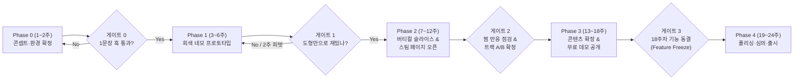
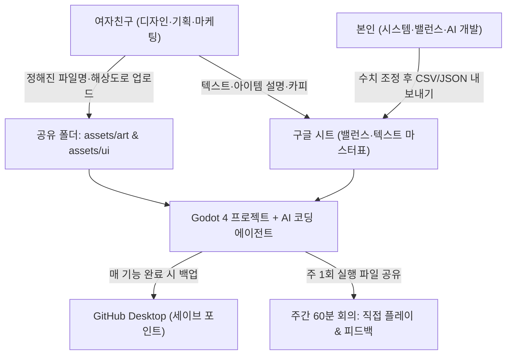

# 커플 2인 첫 스팀 상업 게임 마스터 로드맵 & 협업 가이드

- **기준 문서:** [steam-first-game.md](file:///c:/Users/u34h81/.gemini/antigravity/scratch/couple-steam-game/docs/intent/steam-first-game.md) (확정 의도)
- **확정 게임 명세:** [scrap-to-gold-spec.md](file:///c:/Users/u34h81/.gemini/antigravity/scratch/couple-steam-game/docs/spec/scrap-to-gold-spec.md) *(뜯고 녹여라! — 고물 분해 → 자동화 인크리멘탈)*
- **확정 핵심 방향:** ① 6개월 완주 우선(6월 Next Fest는 유동적 활용) · ② AI 아트 적극 활용 + 여자친구 UI/브랜딩 통합 + 스팀 AI 라벨 투명 공개 · ③ 2D 쇼트 액티브 자동화 인크리멘탈
- **수립일:** 2026-11-22
- **목표 기간:** 2026년 11월 하순 ~ 2027년 5월 하순 (6개월 / 24주)
- **목표 성과:** PC(Steam) 정식 출시 완료 및 초기 매출 **\$1,000 달성** (스팀 등록비 \$100 회수)

---

## 1. 숫자로 보는 현실 역산 (이 게임이 이기는 구조)

본업과 사업을 병행하는 2인 초보 팀이 6개월 안에 상업 매출을 내려면, 감이 아니라 **매출과 시간의 역산**으로 스코프를 먼저 못 박아야 합니다.

### ① 매출 \$1,000 역산
| 항목 | 현실 목표치 | 비고 |
|---|---|---|
| **적정 출시가** | **\$4.99 ~ \$7.99** | 소형 2D 성장·경영·로그라이크 적정 구간 (출시 할인 10~15%) |
| **평균 순매출 단가** | 약 **\$4.00 ~ \$5.50** / 카피 | 지역별 가격·환불 감안 기준 (스팀 등록비 환급은 Adjusted Gross \$1,000 기준) |
| **필요 판매량** | **약 180 ~ 250 카피** | 대작이 아니라 '확실한 취향 저격 소형작'으로 충분히 도달 가능한 수치 |
| **출시 전 목표 찜(Wishlist)** | **1,000 ~ 1,500개** (최소 600개+) | 인디 평균 첫 달 전환율 15~25% 기준 |
| **출시 직후 최우선 과제** | **유료 구매 리뷰 10개 달성** | 스팀 무료 키 제외, 직접 구매 리뷰 10개 이상부터 평가 태그 노출 및 알고리즘 추천 활성화 |

### ② 가용 시간 역산 & 스코프 상한선
- **명목 투입 시간:** 2인 × 주 10시간 × 24주 = **480시간**
- **현실 가용 시간:** 본업 성수기·휴식·변수 버퍼(20%) 제외 = **약 380 ~ 400시간**
- **적정 게임 볼륨 상한:**
  - **플레이타임:** 1회차(또는 1런) **15~30분**, 전체 콘텐츠 **2~5시간 + 리플레이성**
  - **승리 공식:** 방대한 맵·스토리·프레임 애니메이션(물량전)을 완전히 버리고, **① 1초 만에 클릭하게 만드는 독보적 2D 비주얼(여자친구 강점) + ② 적은 오브젝트로 무한 조합이 나오는 성장/경영/로그라이크 규칙(본인 강점)**에 모든 시간을 집중합니다.

> [!IMPORTANT]
> **핵심 원칙 — "적게 그리고, 많이 조합되게 만든다"**
> 캐릭터 8방향 걷기 애니메이션이나 50개 스테이지를 만들면 6개월 안에 절대 못 끝납니다. 정지 2D 아트 + 코드 기반 움직임(튕김·흔들림·파티클) + 30~50개 업그레이드/시너지 조합 구조가 400시간 예산에서 가장 높은 재미와 완성도를 만듭니다.

---

## 2. 2027 스팀 캘린더와 출시 트랙 선택 (핵심 분기점)

현재 시점(2026년 11월 하순) 기준, 실제 **2027년 상반기 스팀 공식 일정**은 다음과 같습니다.

- **2027년 2월 스팀 넥스트 페스트(Next Fest):** 2027.02.22 ~ 03.01 *(등록 마감: **2027.01.10**)*
  → 프로젝트 시작 후 7주 만에 마감되므로 **참가 불가**. (넥스트 페스트는 게임당 **평생 1회만** 참가 가능하므로 미완성 빌드로 소모하면 치명적)
- **2027년 6월 스팀 넥스트 페스트:** 2027.06.14 ~ 06.21 *(등록 마감: **2027.04.25**)*
- **2027년 스팀 여름 세일:** 2027.06.24 ~ 07.08 *(대형 세일 기간 중 인디 신작 출시는 노출이 묻히므로 회피 필수)*

이에 따라 두 분이 선택할 수 있는 현실적인 출시 트랙은 두 가지입니다.

| 구분 | 트랙 A: 6개월 엄수 출시형 | 트랙 B: 6월 Next Fest 부스트형 (추천 검토) |
|---|---|---|
| **개발 완료 시점** | 2027년 5월 초 (동일) | 2027년 5월 말 (개발 노동 기간은 6개월 내 종료) |
| **정식 출시일** | **2027년 5월 중순** | **2027년 7월 중순** (6월 Next Fest → 여름 세일 회피 후 출시) |
| **찜 확보 경로** | 3~5월 무료 데모 + 커뮤니티/스트리머 마케팅 | 3~5월 마케팅 + **6월 Next Fest 무료 스팀 공식 노출 대량 유입** |
| **장점** | 6개월 마일스톤 100% 준수, 체력 소진 최소화 | 마케팅비 \$0으로 찜 1,000개+ 및 \$1,000 초과 달성 확률 대폭 상승 |
| **단점** | 순수 외부 마케팅(여자친구 역량) 의존도가 높음 | 최종 출시일이 6개월 기준보다 약 6~7주 뒤로 이동 |

> [!TIP]
> **추천 의사결정 방식 (하이브리드 게이트):** 지금 당장 무리하게 확정할 필요 없이 **Phase 2 종료 시점(2027년 2월 말, 스팀 페이지 오픈 직후)**의 초기 찜 반응과 개발 속도를 보고 트랙 A / B를 확정하면 가장 안전합니다. 단, 트랙 B 여지를 남기려면 **4월 25일 등록 마감 전까지 데모 준비**가 되어 있어야 합니다.

---

## 3. 6개월 마스터 로드맵 (2026.11 하순 ~ 2027.05 하순)

### Phase 0. 기반 세팅 & 콘셉트 확정 (1~2주차 / 11월 하순 ~ 12월 초, ~40h)
- **목표:** 6개월 안에 완성 가능한 게임 아이디어 1종 확정 + '하지 않을 것(Anti-Scope)' 명문화 + AI 개발 환경 개통
- **본인 (Systems & AI-Dev):**
  - 성장/경영/로그라이크 코어 루프 아이디어 3~5개 초안 작성 및 리플레이성 비교
  - 엔진(Godot 4) + GitHub Desktop + AI 코딩 에이전트 세팅
  - **1일 워밍업:** AI에게 지시해 "클릭하면 숫자가 오르고 도형이 튕기는" 1화면 미니 실행 파일 띄워보기 (코딩 두려움 제거)
- **여자친구 (Visual, Product & Growth):**
  - 스팀 인기 소형 2D 게임 10종의 썸네일(캡슐)·가격·리뷰 분석
  - 후보작별 **비주얼 콘셉트 무드보드 & 가짜 스크린샷(Fake Screenshot) 1장** 제작
  - Notion 협업 보드 및 에셋 폴더 규격표 개설
- **통과 게이트 0:**
  1. 게임의 핵심 재미가 **한 문장**으로 설명되는가?
  2. 가짜 스크린샷 1장을 지인에게 보여줬을 때 "무슨 게임이야? 해보고 싶다"는 반응이 나오는가?
  3. **버릴 기능 목록(Anti-Scope)**에 두 분이 합의했는가?

### Phase 1. '회색 네모' 재미 검증 프로토타입 (3~6주차 / 12월 중순 ~ 1월 초, ~80h)
- **목표:** 예쁜 그림을 하나도 넣지 않고 **도형·텍스트(Greybox)**만으로 핵심 규칙이 진짜 중독성 있는지 검증
- **본인:**
  - AI 코딩으로 코어 게임 루프 1사이클 완성 (입력 → 성장/경영 선택 → 결과/보상 → 다음 라운드)
  - 밸런스 수치를 코드가 아닌 **CSV/JSON 표**로 분리해 매일 플레이하며 숫자 튜닝
- **여자친구:**
  - 최종 아트 스타일 확정 (색상 팔레트, 폰트, UI 컴포넌트 규격, 적은 리소스로 돋보이는 2D 화풍 고정)
  - 게임 가제/브랜드 톤, 타깃 유저 페르소나, 핵심 홍보 포인트(USP 3가지) 정리
  - 핵심 UI 와이어프레임(화면 배치도) 설계 → 본인에게 전달
- **통과 게이트 1 (킬/피벗 게이트 — 가장 중요):**
  - **임시 도형 상태에서도 두 분 스스로 "한 판만 더"를 외치며 15분 이상 플레이하는가?**
  - *미달 시 원칙:* 절대 "예쁜 그림 넣으면 재밌어지겠지"라고 넘기지 말고, 7~8주차에 규칙을 과감히 수정(피벗)합니다.

### Phase 2. 버티컬 슬라이스 & 스팀 페이지 조기 오픈 (7~12주차 / 1월 중순 ~ 2월 말, ~120h)
- **목표:** 실제 출시 퀄리티와 동일한 **15분 분량(1런/1스테이지)** 완성 + **스팀 '출시 예정(Coming Soon)' 페이지 공개**
- **본인:**
  - 여자친구가 넘긴 최종 2D 에셋 적용 + 코드 연출(화면 흔들림, 버튼 탄성, 숫자 팝업, 효과음) 집중 투자
  - 기본 설정(해상도·볼륨), 저장/불러오기 구현, Windows 실행 파일(`.exe`) 첫 패키징
  - Steamworks 파트너 등록 시작 (**\$100 결제 → 30일 대기 기간 카운트 시작!**)
- **여자친구:**
  - **스팀 캡슐 아트(메인 썸네일)** 제작 *(스팀 클릭률의 절반을 결정하는 최고 우선순위 에셋)*
  - 실제 플레이 스크린샷 5장+, 15~30초 핵심 루프 GIF/티저 영상, 영문/국문 스토어 소개글 작성
  - 스팀 페이지 공개 및 초기 SNS(X/레딧/인디 커뮤니티) 첫 노출 시작
- **통과 게이트 2 (3개월 중간 점검):**
  - 스팀 '출시 예정' 페이지 공개 및 Steamworks 세무(W-8BEN)·계좌 검증 완료
  - 공개 후 2주간의 찜 유입 반응을 보고 **트랙 A(5월 출시) vs 트랙 B(6월 Next Fest → 7월 출시)** 최종 결정

### Phase 3. 콘텐츠 확장 & 무료 데모(Demo) 공개 (13~18주차 / 3월 ~ 4월 중순, ~120h)
- **목표:** 리플레이성을 만드는 데이터 확장 + **스팀 무료 데모 배포**로 찜 확보 및 외부 피드백 수집
- **본인:**
  - **신규 시스템 추가 금지!** 이미 만든 틀 안에서 데이터(아이템·업그레이드·이벤트·유물·난이도 단계 등)만 표 기반으로 확장
  - 글 설명을 최소화한 **3분 튜토리얼(온보딩)** 구현 (초반 이탈 방지 핵심)
  - 스팀 무료 데모 빌드 업로드, 외부 테스터 버그 수정, 스팀 업적(10~15개) 연동
- **여자친구:**
  - **무료 데모 홍보 캠페인 집중 가동:**
    - 국내/해외 소형 인디 유튜버·스트리머(구독자 1천~5만 구간) 30~50명 대상 맞춤형 데모 안내 메일 발송
    - 레딧(장르별 서브레딧), X, 틱톡/릴스 숏폼 GIF(10초 내 재미가 보이는 클립) 주 2~3회 배포
    - 국내 인디 커뮤니티(인디게임 개발/유저 커뮤니티) 테스트 모집 및 피드백 취합
  - 부족한 아이콘·UI·엔딩/결과 화면(공유하고 싶은 요약 카드!) 제작
- **통과 게이트 3 (18주차 말 — Feature Freeze):**
  - **신규 기능·콘텐츠 추가 100% 중단.** 이후 떠오르는 모든 좋은 아이디어는 `출시 후 1.1 업데이트 메모`로만 보냅니다.

### Phase 4. 폴리싱, 다국어, 행정 마감 & 정식 출시 (19~24주차 / 4월 하순 ~ 5월 하순, ~80h)
- **목표:** 버그 제로화, 로컬라이징, 스팀/국내 심의 통과, 정식 출시 및 출시 직후 리뷰 10개 달성
- **본인:**
  - 치명적 버그(크래시·세이브 손실·진행 불가) 100% 박멸 및 밸런스 최종 마감
  - 다국어 텍스트 적용: **영어(필수) + 한국어(필수)** + 여력 시 **일본어/중국어 간체** *(스팀 인디 소형작 매출의 큰 비중을 차지; AI 번역 후 용어집 통일 + 테스트)*
  - **출시 3주 전** 스팀 최종 빌드 검수 제출 (검수 지연 최대 12영업일 대비)
  - 출시 당일 핫픽스 대기 및 1~2주차 첫 패치 대응
- **여자친구:**
  - 정식 출시 트레일러(30~45초, 시작 3초 안에 게임플레이 노출!), 최종 스토어 페이지 리뉴얼
  - 출시가 및 출시 할인율(10~15%) 확정, 출시일 선정 (대형 세일·동일 장르 대형작 회피)
  - 데모 플레이어·스트리머(정식 키 배포)·커뮤니티 대상 **출시 알림 및 초기 리뷰 10개 확보 캠페인** 실행
  - 출시 2주 후 수익/찜/리뷰 회고(Post-mortem) 문서 작성

---

## 4. 기술 스택 & AI 제작 파이프라인 (코딩 전무 2인 팀 전용)

### ① 게임 엔진 추천: **Godot 4 (GDScript)** 1순위
2026년 현재, 코딩 경험이 없는 팀이 AI 코딩 에이전트와 협업할 때는 GUI 클릭 위주의 '노코드 툴'보다 **프로젝트 전체가 텍스트 파일로 저장되어 AI가 직접 읽고 수정할 수 있는 엔진**이 압도적으로 빠릅니다.

| 후보 | 평가 | 선정 이유 / 배제 이유 |
|---|---|---|
| **Godot 4 (GDScript)** | **1순위 강력 추천** | 완전 무료·로열티 0% · 2D 및 UI(카드/경영/상점) 제작 최강 · 씬(`.tscn`)과 코드(`.gd`)가 텍스트 기반이라 AI 에이전트 수정·디버깅 궁합 최상 · Python과 닮아 비개발자도 수치 확인 용이 · Steam SDK(`GodotSteam`) 검증 완료 |
| **Web (TypeScript + HTML/CSS) + Electron** | **2순위 조건부 대안** | 실시간 움직임이 거의 없고 **순수 UI·텍스트·카드 경영(90% 이상 UI)** 게임일 때만 고려. AI 코딩 정확도 최강·브라우저 링크로 즉시 공유 가능하나, Steam 연동 및 패키징/이펙트 연출은 Godot보다 손이 더 감 |
| Unity / Unreal | 제외 | 2D 소형작 대비 에디터가 무겁고 컴파일/바이너리 충돌·설계 복잡도가 커서 주 10시간 비개발자 팀에 과부하 |
| 노코드 툴 (GDevelop 등) | 제외 | 초반 2주는 쉬우나, AI 코딩 에이전트가 코드를 직접 수정·리팩토링하기 어려워 중반 이후 생산성이 급락 |

> [!TIP]
> **AI 코딩 사고 예방법 (Godot 4 기준):**
> AI가 구버전(Godot 3) 문법을 섞어 쓰지 않도록 프로젝트 최상단에 `Godot 4.x 전용 규칙 파일`을 두고, 기능을 1개 추가할 때마다 **GitHub Desktop에서 커밋(세이브 포인트)**을 남깁니다. 또한 Phase 1에 **디버그 치트 패널(골드 추가, 라운드 즉시 이동, 승패 강제 테스트)**을 먼저 만들어 두면 밸런스 검증 시간이 절반으로 줄어듭니다.

### ② Steam AI 공개 정책 대응 전략 (매우 중요!)
Valve의 스팀 AI 정책은 **"개발 뒤편의 효율 도구"**와 **"플레이어가 직접 보는 결과물"**을 명확히 구분합니다.

| 영역 | 스팀 AI 라벨 공개 의무 | 커플 팀 최적 전략 |
|---|---|---|
| **AI 코딩·디버깅·번역 초벌·기획 브레인스토밍** | **공개 불필요 (면제)** | 100% 적극 활용! (코드 작성, 밸런스 시뮬레이션, 버그 수정) |
| **인게임 아트·배경·캡슐 아트·음원 (플레이어 노출)** | **공개 필수** *(스토어 페이지에 AI 사용 배지 및 설명 표시)* | **전략 선택 필요:** 스팀 인디 유저 중 AI 아트에 거부감을 느끼는 층이 존재합니다. • **권장(라벨 회피형):** AI는 시안·구도 참고용으로만 쓰고, 최종 인게임 아트와 캡슐 아트는 **여자친구가 일관된 스타일(심플 벡터·플랫·콜라주·도형 미감 등)로 직접 완성/리터칭** + 사운드는 저작권 깔끔한 무료/저가 인디 에셋팩 사용. • **속도형(투명 공개형):** 시간 절약을 위해 AI 생성 에셋을 일부 최종 빌드에 넣기로 합의했다면, 리터칭으로 이질감을 없애고 스팀 AI 설문에 투명하게 기재. |

### ③ 파일 충돌 0% 협업 파이프라인
여자친구가 코드나 엔진 에디터를 직접 건드리지 않아도 자연스럽게 협업되도록 **경계를 물리적으로 분리**합니다.

---

## 5. 커플 2인 협업 운영 헌장 (관계·본업 보호 시스템)

커플 인디 팀이 중도 하차하는 이유의 80%는 기술이 아니라 **역할 경계 모호, 완벽주의 충돌, 데이트와 업무의 혼재**입니다. 아래 3가지 장치를 시작 전에 합의하고 들어갑니다.

### ① 역할 및 최종 결정권(DRI) 분리표
서로 의견은 자유롭게 내되, **토론이 10분 이상 평행선이면 해당 영역의 최종 결정권자(DRI)가 결정하고 상대는 쿨하게 따릅니다.**

| 영역 | 최종 결정권자 (DRI) | 핵심 책임 |
|---|---|---|
| **게임 규칙·밸런스·구현** | **본인** | 코어 루프 설계, 난이도·성장 수치 튜닝, AI 코딩·버그 수정, 스팀 빌드·업적 연동 |
| **비주얼·브랜드·마케팅·일정** | **여자친구** | 2D 아트 디렉션·UI 미감, 제목·캡슐 아트·스토어 페이지, 커뮤니티·스트리머 홍보, 주간 마일스톤 관리 |
| **공동 결정 (딱 4가지만)** | **2인 합의 필수** | ① 최종 게임 콘셉트 선정 ② 스코프 컷/피벗 결정 ③ 예산 지출(추가 비용 발생 시) ④ 출시 가격 및 출시일 |

### ② 주 10시간 리듬 (주간 운영 루틴)
- **비동기 각자 작업 (주 8.5~9시간):** 각자 본업/사업 일정에 맞춰 편한 시간에 집중 작업 *(평일에 "오늘 몇 시간 했어?" 감시 절대 금지)*
- **주 1회 '스튜디오 회의' (딱 60분, 타이머 필수):**
  1. **[00~15분] Show, Don't Tell:** 말로 설명하지 않고 이번 주 최신 빌드를 직접 10분 플레이
  2. **[15~30분] 칭찬 1개 + 블로커 공유:** 서로 잘한 점 1가지씩 짚고, 막힌 부분(필요한 에셋/수치/결정) 공유
  3. **[30~50분] 다음 주 할 일 확정:** 각자 **최대 3개 이하의 완료 가능한 작업**만 Notion 보드에 등록
  4. **[50~60분] 스코프 경보 체크:** "이번 주에 원래 없던 기능을 몰래 늘리지 않았는가?" 점검

### ③ 관계 방화벽 (Relationship Firewall)
1. **데이트 시간 게임 금지:** 주간 회의 타이머가 울리면 즉시 작업 모드 종료. 데이트 중에는 상대가 먼저 꺼내지 않는 한 진도·버그·마감 이야기를 꺼내지 않습니다.
2. **월 1회 공식 '패스권':** 본업이나 사업이 몰리는 주에는 미리 공유하고 해당 주 작업을 3~5시간으로 줄일 수 있는 패스권을 월 1회씩 공식 인정합니다. (눈치·죄책감 차단)
3. **비판 대상은 '사람'이 아니라 '빌드':** "네가 만든 UI가 답답해" 대신 **"이 화면에서 버튼이 작아서 클릭이 헷갈려"**처럼 화면과 플레이어 시점으로만 피드백합니다.

---

## 6. 최소 비용 예산표 & 한국 스팀 출시 행정 체크리스트

### ① 예상 비용 구조 (외주 없음 원칙)
| 항목 | 예상 비용 | 구분 | 비고 |
|---|---|---|---|
| **Steam Direct 앱 등록비** | **\$100** (약 14만 원) | **필수** | 조정 총매출 \$1,000 달성 시 스팀이 환급 |
| AI 개발/기획 도구 | 기존 사용 툴 활용 (\$0~월 구독) | 기존 활용 | 추가 유료 툴 도입 시 사전 협의 |
| 효과음/BGM 인디 에셋팩 | \$0 ~ \$30 | 선택 (협의) | CC0 무료 소스 우선, 필요 시 상업 라이선스 깔끔한 저가 팩 구매 |
| 국내 게임물관리위원회 심의 | 아래 행정 항목 참조 | 사전 확인 | 국내 유료 유통 전략에 따라 Phase 2에 판단 |

### ② Phase 2(2027년 1~2월)에 반드시 점검할 행정 체크리스트
출시 직전에 부딪히면 일정이 1~2개월씩 밀리는 항목들입니다. **3개월차에 미리 확인**해야 합니다.

1. **스팀웍스 30일 대기 + 14일 Coming Soon 규정:**
   - Steam Direct \$100 결제 후 **최소 30일**이 지나야 출시 가능하며, 스토어 페이지가 **최소 14일 이상 '출시 예정'** 상태로 공개되어 있어야 합니다. (두 기간은 겹칠 수 있음 → **2월 말 스팀 페이지 오픈으로 여유롭게 해결**)
2. **세무 및 정산 계정 형태 (W-8BEN):**
   - 스팀웍스는 개인(Individual) 또는 사업자 등록 모두 가능하며, 정산 시 온라인으로 **W-8BEN**(한·미 조세조약 적용 서식)을 작성합니다.
   - 여자친구께서 이미 사업을 운영 중이시므로, **기존 사업자에 업종(게임 소프트웨어 개발 및 공급업)을 추가할지 / 별도 개인·신규 사업자로 정산할지** 세무사(또는 홈택스 기준)와 Phase 2 초기에 한 번만 확인해 두세요.
3. **한국 게임물관리위원회(GRAC) 등급분류:**
   - 스팀은 한국의 '자체등급분류사업자'가 아니므로, 한국 이용자를 대상으로 유료 게임을 유통하려면 원칙적으로 등급분류(심의) 대상이 됩니다.
   - Phase 2(2월)에 최신 소규모/개인 인디 게임 심의 절차·수수료·소요 기간(보통 수 주 소요)을 확인하여 **① 출시 6주 전 정식 심의 신청**할지, **② 초기 출시 지역 전략을 어떻게 가져갈지** 미리 결정해야 합니다.

---

## 7. 초보 커플 팀 5대 실패 함정 & 사전 방어막

| 흔한 실패 함정 | 우리 팀의 사전 방어막 |
|---|---|
| **1. 완벽한 기획서만 쓰다가 2개월 소모** | **2주차 말 기획 무조건 동결.** 3주차부터 회색 네모라도 돌아가는 실행 파일 제작 시작 |
| **2. AI 코드가 길어지면서 기존 기능 파괴** | 기능 1개씩 작은 파일 단위로 지시 + 작업 전마다 **GitHub Desktop 커밋** + 디버그 치트 패널 우선 구축 |
| **3. 2D 아트 작업량 폭증 (애니메이션 지옥)** | **정지 2D 아트 + 코드 트윈(크기·회전·흔들림·파티클) 연출** 원칙. 프레임 애니메이션 금지 |
| **4. 출시 2주 전에 스팀 페이지 오픈 → 찜 30개** | **12주차(2월 말) 스팀 페이지 조기 공개** + 15~18주차 무료 데모 공개로 최소 3개월간 찜 축적 |
| **5. 4개월차 번아웃 & 기능 욕심 폭발** | **18주차 기능 동결(Feature Freeze)** + 월 1회 패스권 + 데이트 시 게임 이야기 금지 |

---

## 8. 바로 시작할 Next Step (이번 주 체크리스트)

다음 단계인 **게임 콘셉트 구체화(`idea-refine`)**로 넘어가기 전에, 두 분이 이번 주 30분 커피 타임에서 아래 **3가지**만 가볍게 정리해 오시면 바로 다음 작업을 시작할 수 있습니다.

1. **AI 아트 정책 기준 정하기:**
   - *안 A (추천):* AI는 코드·기획·시안 참고용으로만 쓰고, 최종 게임 아트/캡슐은 여자친구가 직접 마무리해 **스팀 AI 라벨 없이 출시**
   - *안 B:* 제작 속도를 최우선으로 일부 AI 생성 에셋을 최종 빌드에 포함하고 **스팀 AI 라벨을 투명 공개**
2. **출시 트랙 잠정 선호 확인:**
   - *트랙 A (6개월 엄수, 2027년 5월 중순 출시)* vs *트랙 B (개발 6개월 + 6월 Next Fest 참가 후 7월 중순 출시)* *(※ 3개월차 중간 게이트에서 최종 확정 가능)*
3. **취향 레퍼런스 메모 (각자 2~3개씩):**
   - **본인:** "규칙이 단순한데 한 판만 더 하게 됐던" 성장/경영/로그라이크 게임 2~3개
   - **여자친구:** "스팀 썸네일만 봐도 클릭하고 싶은 / 내가 직접 스타일을 뽑아낼 수 있는" 2D 비주얼 레퍼런스 2~3개
