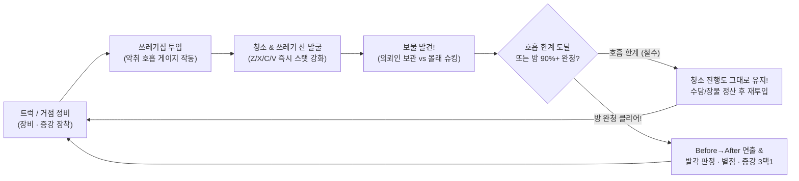

# 게임 기획 확정서 v1.0 — 3D 쓰레기집 특수청소 프로젝트 (가제: TrashCleaner3D)

> **목적:** 여자친구와 개발 방향·규칙·역할을 100% 동일하게 공유하기 위한 구상 확정 문서입니다.  
> **상태:** 핵심 컨셉·규칙 확정 완료 (본격 제작 전 에셋 탐색 및 프로토타입 준비 단계)

---

## 1. 프로젝트 한눈에 보기

| 항목 | 확정 내용 |
|---|---|
| **장르** | **3D 1인칭** 특수청소 × 보물 발굴 × 인크리멘탈 + 도둑질(서브 기믹) |
| **장르 비중** | **메인 70%:** 청소 + 쓰레기 산 보물 발굴 + 장비 성장 / **서브 30%:** 도둑질(슈킹) 기믹 |
| **한 줄 컨셉** | *“악취 나는 한국형 쓰레기집을 치우고 보물을 파내며 장비를 진화시키고, 할부금 압박 속에 집주인 몰래 귀중품을 슈킹할지 고민하는 3D 특수청소 게임”* |
| **타겟 플랫폼 / 가격** | PC (Steam) / **7,000 ~ 8,000원대 (`$5.99 ~ $6.99`)** |
| **엔진 / 파이프라인** | **Unity 6 (`6000.6.10f1`) · Universal 3D (URP)** |
| **개발 기간 & 예산** | 기간 유연 조정 / 필요 시 유료 3D 소품팩 소자본 투자 / AI티는 철저히 검수해 배제 |

---

## 2. 비주얼 & 그래픽 기준선

- **목표 분위기:** `Cellar Keeper`의 묵직하고 어두운 밀폐 실내 톤 + **한국 2030 쓰레기 원룸**의 현실 밀착 디테일
  - 공간 구성: 좁은 직사각형 원룸, 누런 아이보리 벽지, 포인트 현관문, 소형 냉장고+전자레인지, 화장대, 이불 등 기본 가구 6~8종 고정 배치
  - 쓰레기 구성: 묶인 흰색/반투명 비닐봉투 산더미(70%) + 피자박스·배달용기·택배박스·페트병(20%) + 바닥 얼룩 데칼 & 숨겨진 보물(10%)
- **시인성 & Before → After 쾌감 장치:**
  - 시작 시: 칙칙한 원룸 형광등(Baked Light) + 구석 SSAO 음영 + 옅은 먼지 안개(Fog) + 플레이어 손전등/조준 외곽선(Outline) + 보물 은은한 반짝임
  - 청소율 상승(`50% → 80% → 100%`): 안개와 누런 색보정이 서서히 걷히며 **환하고 뽀송한 햇살 톤**으로 극적 전환!
- **에셋 조달 전략:**
  - 1차 무료 탐색: **Fab (Quixel Megascans 무료)**, **Poly Haven**, **ambientCG**, **CG Bookcase**, **Sketchfab (CC0)** *(반드시 1K~2K 텍스처 + 저폴리곤 LOD 버전 사용)*
  - 2차 보완: 무료로 통일감이 안 맞는 핵심 소품(쓰레기봉투·청소도구 등)은 Unity Asset Store **URP 지원 유료 팩** 소자본 구매

---

## 3. 코어 게임 루프 (악취 호흡 한계 + 진행도 누적)

단순 제한시간 실패(방 리셋) 방식은 청소 성취감을 해치므로, **「악취 호흡(체류 시간) 한계로 2~4회 왕복하며 방을 점점 비워나가는 누적 탐험형」**으로 확정합니다.

- **초반 디메리트 → 해방감 설계:**
  - 1트라이는 **맨손 + 마스크 없음**으로 시작해 악취 호흡이 금방(45~60초) 닳아 20~30%만 치우고 철수.
  - **첫 3~5분 안에 첫 업그레이드(마스크/도구)**를 바로 체험해 “업글하니까 확 편해진다!”는 인크리멘탈 쾌감을 초반에 즉시 제공.
- **완료 판정 QoL (버그 방지):**
  - 100% 강제 시 잔쓰레기 1개 못 찾아 스트레스 유발 → **청소율 90~92% 달성 시 잔여물 자동 정화 연출로 클리어 처리.**
- **재방문(선택적 파밍) 설계:**
  - 캠페인 진행은 **강제 노가다 없이 1회 클리어**로 다음 집 해금.
  - 이미 깬 방은 **“단골 집주인 재발 의뢰 / 옆 호실”** 명분으로 쓰레기·보물 위치가 랜덤 리스폰되어, 돈·도감 파밍이나 강화 장비 무쌍을 원하는 유저만 선택적으로 재방문 가능.

---

## 4. 장비 3종 진화 & 이원화 성장 시스템

### ① 장비 3종 (단축키 `1, 2, 3` 또는 마우스 휠)
| 장비 슬롯 | 역할 | 진화 예시 (스테이지/퀘스트 해금) |
|---|---|---|
| **1. 수거/흡입 장비** | 쓰레기 산 파내기 & 보물 발굴 | 맨손 → 집게·봉투 → 가정용 청소기 → 공업용 흡입기 → 초강력 흡입기 |
| **2. 오물/얼룩 장비** | 바닥·벽 곰팡이·국물 데칼 제거 | 마른 걸레 → 대걸레 → 스팀건 → 고압세척기 |
| **3. 생존/탐지 장비** | 악취 체류 시간 증가 & 보물·CCTV 탐지 | 마스크 없음 → 일회용 마스크 → 방독면 → **보물/CCTV 탐지 고글** |

### ② 이원화 성장 구조 (실시간 강화 + 완청 증강)
1. **현장 실시간 강화 (돈 소비 · 단축키 `Z, X, C, V`):**
   - 화면 구석에 작은 아이콘 4개만 배치(흡입 속도 / 흡입 범위 / 악취 저항 / 가방 용량)해 메뉴 열지 않고 시점 끊김 없이 즉시 강화.
   - 과도한 선행 스펙업은 **가격 급상승 곡선**으로 자연 제어 + 다음 티어 장비 자체는 스테이지 해금으로 이중 제어.
2. **방 완청 보상 — 증강(Augment) 카드 (3택 1):**
   - 단순 스탯이 아니라 플레이 스타일을 바꾸는 특수 효과 *(예: 50개 흡입마다 흡입 범위 2배 피버 / CCTV 스캔 속도 40% 저하 / 얼룩 제거 시 이속 중첩 / 보물 가치 1.5배 대신 발각률 상승 등)*.
   - **1막 (빚/할부금 캠페인):** 기본 **2칸 → 최대 4칸** 슬롯 제한(퀘스트/돈으로 확장, 거점에서 무료 교체)으로 **청소 특화 vs 슈킹 특화 빌드 선택의 재미** 유지.
   - **2막 (엔딩 후 무한모드):** 슬롯 제한을 돈으로 계속 확장해 **결국 모든 증강을 다 끼고 방을 싹쓸이하는 인크리멘탈 끝판왕 쾌감** 제공.

---

## 5. 도둑질(슈킹) 서브 기믹 규칙

진행을 느리게 만드는 복잡한 잠입은 배제하고, **‘걸릴까 말까 하는 쫄깃한 선택’**에만 집중합니다.

- **핵심 긴장감:** 빚/할부금 마감 압박 때문에 정직하게 청소비만 받으면 아슬아슬하고, 자꾸 보물 슈킹의 유혹에 흔들리게 설계.
- **복합 발각률 공식 (억까 방지):**
  - **보물 금액(가치 비율) + 훔친 개수** 두 가지를 복합 반영해 발각률 산출.
  - 현재 방의 **누적 예상 발각률(`%`)을 UI에 투명하게 실시간 표시** → 플레이어가 스스로 멈출지 도박할지 결정.
- **업그레이드 한계선 (절대 100% 안전 불가):**
  - 적정 슈킹 구간(방 보물의 50% 이하 등): 풀업그레이드 시 **발각률 5~10% 이하**로 크게 완화해 성장 체감 극대화.
  - **싹쓸이 구간(80~100% 전부 슈킹):** 풀업 상태에서도 **절대 발각률 0%가 되지 않게(최소 25~35% 유지)** 설계해 끝까지 쫄깃함 유지.
- **현장 기믹:** 의뢰인이 메모로 콕 집어 부탁한 분실물(슈킹 시 100% 발각) + 방 구석 고정 CCTV 1~2대(스캔 피하거나 거품으로 가리기).

---

## 6. 2인 1:1 분담 원칙 & 3D 최적화·협업 규칙

### ① 2인 협업 분담 (충돌 방지 폴더 분리)
- **파트 A (시스템·로직):** Unity C# 스크립트(`Scripts/`), 청소·발굴·슈킹·증강 시스템, 밸런스 수치(`Data/`), 최적화, 스팀 빌드.
- **파트 B (레벨·데이터·검수·마케팅):** Unity 에디터 방 배치·가구/쓰레기/보물 세팅(`Scenes/`), 에셋 통일성 및 AI티 검수, 의뢰 메모·별점 리뷰 기획, UI 아이콘·스팀 스토어/숏폼 마케팅.
- **⚠️ Git 충돌 방지 절대 규칙:** 두 사람이 **같은 씬(`.unity`) 파일을 동시에 수정하지 않습니다.**

### ② 3D 최적화 4대 기본 원칙 (개발 1일차부터 적용)
1. **물리(Rigidbody) 상시 OFF:** 바닥 쓰레기는 정적(Static) 유지, 흡입 시에만 스크립트로 이동 후 비활성화.
2. **덩어리 + 소품 혼합:** 비닐봉투 산더미는 대형 덩어리 프리팹(축소형) 15~25개 + 표면 소품 50~80개로 구성.
3. **Object Pooling & Occlusion Culling:** 쓰레기·파티클 재활용, 안 보이는 구역 렌더링 제외.
4. **Baked Lighting:** 기본 원룸 조명은 정적 굽기(Bake), 실시간 그림자는 손전등 등 최소 1개만 사용.

---

## 7. 다음 진행 단계 (제작 착수 전 체크리스트)

1. **에셋 1차 수집:** `Fab (Megascans)` / `Poly Haven` / `ambientCG`에서 벽지·장판·얼룩 데칼·쓰레기봉투 후보 선별 (부족한 핵심 소품만 Unity Asset Store 유료팩 후보 리스트업)
2. **콘텐츠 초안 표 작성:** 캠페인 방 **5~6개 테마** + **증강 카드 12~16종** 리스트 확정
3. **2주 3D 핵심 손맛 프로토타입:** 방 1칸(원룸)에서 **1인칭 이동 + 악취 호흡 + 쓰레기 덩어리 흡입 + 보물 슈킹 + 발각률 판정**이 실제로 재밌는지 검증 후 본 제작 진입
