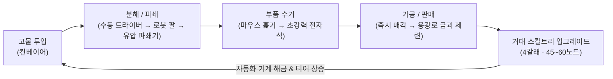

# 게임 기획·기술 명세서 v1.1 (확정): 뜯고 녹여라! (가제: Scrap to Gold)

- **기준 문서:** [steam-first-game.md](file:///c:/Users/u34h81/.gemini/antigravity/scratch/couple-steam-game/docs/intent/steam-first-game.md) · [master-roadmap.md](file:///c:/Users/u34h81/.gemini/antigravity/scratch/couple-steam-game/docs/plan/master-roadmap.md)
- **작성일:** 2026-11-22 (v1.1 확정 반영)
- **장르:** 2D 쇼트 액티브 자동화 인크리멘탈 (Short Active Incremental)
- **진행 리듬 (확정):** **끊김 없는 연속 작업대 + 오버클럭 피버 (`Potato Please`식)**
- **화풍 톤 (확정):** **밝고 아기자기한 코지 공방 톤** (따뜻한 우드·파스텔 공방 + 통통하고 선명한 2D 오브젝트)
- **목표 볼륨 / 가격:** 플레이타임 **2.5 ~ 4시간 완결형 (엔딩 + 무한 모드)** / 출시가 **\$4.99 ~ \$5.99**
- **비주얼 & AI 정책:** **AI 아트 적극 활용 + 여자친구 UI/색감/브랜딩 통합 + 스팀 AI 라벨 투명 공개**
- **출시 트랙:** **6개월 완주(2027년 5월) 기본**, 2027년 6월 Steam Next Fest는 3개월차 게이트에서 유동적 활용

---

## 1. 게임 한 줄 정의 & 스팀 판매 훅

> **"나사 하나씩 풀던 1평 고물상이, 전자석·유압 파쇄기·황금 용광로로 외계 우주선까지 통째로 으깨 금괴를 뽑아내는 2D 자동화 인크리멘탈"**

### 10초 바이럴 GIF 설계 (스팀 찜·숏폼의 핵심)
- **0~4초 (의도된 답답함 + 아기자기한 손맛):** 햇살 드는 따뜻한 나무 작업대에서 마우스로 동글동글한 레트로 카세트 라디오의 나사 4개를 *드르륵, 드르륵* 풀고 구리선 1개 팔아 **\$3** 획득.
- **5~10초 (극적인 해방감 반전):** *"2시간 뒤"* — 알록달록한 초대형 유압 파쇄기가 외계 우주선 잔해를 **콰앙!!** 으깨고, 자석 크레인이 수백 개 반짝이는 황금 칩을 용광로로 빨아들이며 숫자가 **\$9,940,000**으로 폭발!

---

## 2. 코어 게임 루프 & 4단계 성장 곡선



### 진행 방식: 끊김 없는 연속 작업대 + '고철 폭주(오버클럭)' 피버
- **기본 구조:** 팩토리오식 자유 배치가 아니라, **고정 슬롯 5개**에 기계가 하나씩 설치되어 쉬지 않고 돌아가는 **1화면 진화형 작업대**.
- **폭발 도파민 장치 (피버 & 보스 고물):**
  - 분해/파쇄로 게이지가 차면 **[오버클럭! 고철 폭주]** 발동 → 20초간 컨베이어 속도 3배 + 콤보 배수 폭발!
  - 각 티어 목표 금액을 모으면 **티어 보스 고물**(초대형 브라운관 TV → 폐차 스포츠카 → 전투 메카 → 추락한 외계 모선)이 등장해 뜯고 녹이는 쾌감과 함께 다음 공장 해금!

### 4단계 '단순 노동 → 미친 자동화' 곡선

| 단계 | 예상 시간 | 공장 배경 / 고물 티어 | 핵심 플레이 경험 | 플레이어 심리 변화 |
|---|---|---|---|---|
| **Stage 1. 수동 분해** | 0~15분 | 햇살 드는 1평 공방<br>*(라디오·토스터·키보드·선풍기·TV)* | 마우스로 나사 위에 올려 **드르륵!** 해제 → 껍질 열리면 부품 슥 훑기 | *"손맛 좋은데… 나사 너무 많다! 기계 없나?"* |
| **Stage 2. 반자동 & 자석** | 15~50분 | 파스텔 창고 공방<br>*(세탁기·자판기·오토바이·폐차)* | **로봇 드라이버 팔 + 초강력 전자석 + 자동 컨베이어** 해금 | *"오! 내가 안 움직여도 쏙쏙 빨아들이네!"* |
| **Stage 3. 유압 파쇄 & 제련** | 50~120분 | 알록달록 토이·로봇 팩토리<br>*(서버 랙·굴삭기·드론·전투 메카)* | **유압 파쇄기(나사 무시하고 통째로 와장창!) + 황금 용광로** 해금 | *"나사 풀던 내가 바보였네ㅋㅋ 화면 미쳤다!"* |
| **Stage 4. 우주 제련 제국** | 120~210분 | 구름 위 밝은 우주 공방<br>*(인공위성·로켓·UFO·외계 모선)* | **레이저 커터 + 더블 컨베이어 + 출하 드론** 풀가동 → 최종 보스 제련 엔딩 | *"완벽한 엔딩! 공유 카드 찍고 무한 모드 돌리자"* |

> [!TIP]
> **본인(밸런스 담당)의 핵심 재미 설계 포인트 — 유압 파쇄기 트레이드오프:**
> Stage 3에 처음 유압 파쇄기를 열면 속도가 10배 빨라지는 대신 **'부품 손실률(찌그러짐) 40%'**가 붙습니다. 이후 스킬트리에서 *정밀 칼날 · 자동 거름망 · 2연속 프레스*를 찍어 손실률 0% + 보너스 파편 2배로 뚫어내는 순간이 가장 강한 성취감을 만듭니다.

---

## 3. 화면 구성 (단 2개 화면으로 스코프 고정)

6개월(실가용 400시간) 완주를 위해 **맵 이동·스토리 대화·인벤토리 복잡한 관리**를 전부 배제하고 딱 2개 화면만 만듭니다.

### 화면 1: 메인 공장 작업대 (Workbench)
- **상단 HUD:** 보유 현금(`$`), 초당 수익(`$/s`), 현재 티어 목표/보스 게이지, `[스킬트리]` `[도감]` `[설정]` 버튼
- **중앙 캔버스 (화면 75% — 고정 슬롯 5개):**
  1. `Slot 1 [투입구]`: 수동 소환 버튼 → 자동 컨베이어 → 고속 더블 컨베이어
  2. `Slot 2 [분해 구역]`: 빈 작업대 → 자동 드라이버 로봇 팔 → **유압 파쇄기** → **레이저 절단기**
  3. `Slot 3 [수거 구역]`: 마우스 수거 → **초강력 전자석 크레인**
  4. `Slot 4 [가공 구역]`: 없음 → **용광로 (구리괴 → 은괴 → 금괴 → 우주 합금괴 자동 주조)**
  5. `Slot 5 [출하구]`: 판매 상자 → 자동 화물 컨베이어 → 출하 드론
- **하단 컨트롤 바:** 수동 도구 표시(드라이버 → 전동 → 플라즈마) + **[오버클럭 피버]** 버튼 + 퀵 통계

### 화면 2: 거대 스킬트리 (Tech Tree 오버레이)
마우스 드래그·휠 줌으로 뻗어 나가는 **4갈래 · 총 48~55개 노드** 구성:
- **🔧 노랑 (수동 도구):** 나사 해제 속도, 마우스 범위, 크리티컬 뜯기, 피버 지속/배수
- **🤖 파랑 (자동화 기계):** 로봇 팔, 전자석, 유압 파쇄기, 용광로, 레이저 커터 및 각 기계 속도·강화
- **💎 초록 (부품·제련 가치):** 희귀 금칩 확률, 제련 순도 배수, 파쇄 손실률 감소, 콤보 보너스
- **🏭 빨강 (공장 티어·물류):** 컨베이어 속도, 티어 2~4 해금, 보스 고물 호출, 최종 프로젝트 해금

---

## 4. AI 아트 가이드 & 전체 에셋 예산표 (여자친구 담당 영역)

**핵심 목표:** 미술(그림) 실력이 없어도 **AI 생성 + 브랜드 디자인 감각(색감·배치·UI)**으로 스팀에서 "와 깔끔하고 개성 있다"는 평가를 받는 것.

### ① 통일 화풍 가이드 (밝고 아기자기한 코지 공방 — AI 슬롭 방지 3원칙)
1. **화풍 고정:** `부드럽고 둥근 다크 브라운 외곽선 + 따뜻한 파스텔·비비드 컬러 + 아기자기한 코지 2D 일러스트 스티커 스타일` *(단일 프롬프트 템플릿으로 모든 오브젝트 생성)*
2. **밝은 톤에서도 시인성을 지키는 명도 대비 설계:**
   - 작업대/바닥 배경: **따뜻한 미드톤 우드·세이지 그린·소프트 크림 매트** (채도를 낮춰 눈 피로 최소화)
   - 고물·부품·금괴·스파크: **채도가 높은 코랄·머스타드 옐로·민트·반짝이는 골드 + 진한 갈색 외곽선** (밝은 배경에서도 오브젝트가 또렷하게 튀어나오고 스팀 썸네일 시인성 확보!)
3. **프레임 애니메이션 0개 원칙:** 모든 기계와 고물은 **정지 2D PNG**로만 준비하고, 상하 파쇄·진동·통통 튀는 탄성(Squash & Stretch)·반짝임 파티클은 **Godot 4 코드(Tween + Particle)**로 살려냅니다.

### ② 전체 에셋 수량 상한표 (총 약 95장 — 6개월 여유 분량)

| 카테고리 | 수량 | 세부 구성 | 제작 방식 |
|---|---:|---|---|
| **고물 오브젝트** | **34장** | 17종 × 2상태(온전 1장 + 뚜껑 열림/속살 1장)<br>T1(5종) · T2(4종) · T3(4종) · T4(4종) | AI 동일 프롬프트 생성 → 배경 제거·색감 보정 |
| **부품 & 주괴 아이콘** | **12장** | 나사·철판·구리선·PCB·배터리·기어·금칩·코어 + 구리/은/금/우주 합금괴 | AI 생성 → 외곽선/크기 통일 (`128×128 PNG`) |
| **고정 슬롯 기계** | **15장** | 5종 기계 × 2~3단계 외형 (팔·자석·프레스·용광로·레이저) | AI 생성 → 파츠 분리(예: 프레스 몸체 + 내려오는 철판 2장) |
| **공장 배경** | **4장** | T1 햇살 드는 1평 나무 작업대 → T2 파스텔 창고 공방 → T3 알록달록 토이·로봇 팩토리 → T4 구름 위 밝은 우주 공방 | AI 생성 → 채도/대비 정돈해 오브젝트 돋보이게 보정 |
| **스킬트리 아이콘** | **20장** | 4갈래 공용/핵심 아이콘 (레벨업 노드는 재활용) | AI 생성 또는 깔끔한 단색 심볼 통일 |
| **UI 프레임 & 캡슐 아트** | **10장** | 버튼·패널·배지·스팀 스토어 캡슐 세트(메인/헤더/라이브러리) | **여자친구 디자인 주도** (AI 요소 + 직접 타이포·레이아웃) |

### ③ 사운드(SFX) 리스트 — 타격감의 절반!
저작권이 깔끔한 CC0 무료 소스 또는 저가 상업 에셋팩(\$10~\$20)으로 확보 *(AI 음원 비추천)*:
- 나사 풀기(*드르륵*), 뚜껑 열기(*철컥*), 부품 수거(*띠링!* — 연속 수거 시 코드로 음정 점점 상승!), **유압 파쇄기(*콰앙!!*)**, 전자석(*위이잉*), 용광로(*치이익*), 업그레이드 구매(*찰칵*), 보스 등장 경보(*삐용!*)

### ④ 스팀 AI 공개란 작성 초안 (투명 공개 원칙)
> *"일부 2D 고물·부품·배경 그래픽 요소 제작에 생성형 AI 도구를 활용했으며, 모든 이미지의 선별·보정·일관성 통일과 전체 UI/UX 디자인, 게임 시스템 및 밸런스는 개발팀이 직접 설계하고 편집했습니다."* *(번역에도 AI를 쓴다면 로컬라이징 항목도 함께 투명 기재)*

---

## 5. 기술 아키텍처 (Godot 4 + AI 코딩 충돌 제로 설계)

코딩 경험이 없어도 AI 코딩 에이전트가 코드를 안전하게 짜고, 본인이 **코드 수정 없이 밸런스만 조정**할 수 있도록 **데이터와 로직을 완전히 분리**합니다.

```text
scrap-to-gold/
├── project.godot
├── AGENTS.md                 # AI 코딩용 Godot 4.x 규칙서 (구버전 문법 방지)
├── data/                     # ★ 본인이 밸런스 수치만 고치는 데이터 폴더
│   ├── scraps.json           # 고물 17종 (티어, 나사 수, 체력, 드롭 부품)
│   ├── parts.json            # 부품 12종 (가격, 제련 결과, 희귀도)
│   └── skills.json           # 스킬 50노드 (비용 공식, 효과, 선행 노드, 좌표)
├── assets/                   # ★ 여자친구가 정해진 파일명으로 올리는 폴더
│   ├── scraps/               # 예: t1_radio_closed.png, t1_radio_open.png
│   ├── parts/                # 예: part_copper.png, ingot_gold.png
│   ├── machines/             # 예: crusher_body.png, crusher_head.png
│   ├── backgrounds/
│   ├── ui/
│   └── audio/
└── scripts/                  # ★ AI 코딩 에이전트가 관리하는 핵심 모듈 6개
    ├── GameManager.gd        # 재화, 티어, 세이브/로드, 통계, 디버그 치트
    ├── WorkbenchController.gd# 고물 스폰, 컨베이어 흐름, 피버/오버클럭
    ├── ScrapItem.gd          # 나사 해제, 뚜껑 열림, 파쇄 파편 폭발
    ├── PartDrop.gd           # 탄성 튕김, 마우스/전자석 흡입, 판매/제련
    ├── AutomationSlots.gd    # 로봇 팔·자석·파쇄기·용광로·레이저 동작 및 연출
    └── SkillTreeUI.gd        # 드래그/줌 스킬트리 렌더링 및 구매 처리
```

---

## 6. 하지 않을 것 (Anti-Scope — 6개월 완주 생명선)

아래 기능은 개발 중 아무리 욕심이 나더라도 **1.0 정식 출시 전까지 절대 추가하지 않습니다.**
- ❌ 컨베이어 벨트·기계 자유 배치(팩토리오식 그리드 건설)
- ❌ 복잡한 부품 보관 창고/인벤토리 슬롯 관리 (모든 부품은 즉시 판매 또는 용광로 자동 투입!)
- ❌ NPC 스토리 컷신·대화 시스템·멀티플레이어·모바일 빌드
- ❌ 복잡한 손그림 프레임 애니메이션
- ❌ 4개 이상의 추가 공장 티어 (T1~T4로 완벽히 닫힌 엔딩 후, 원하면 출시 후 무료 업데이트/DLC로 확장!)

---

## 7. Phase 1 '회색 네모 프로토타입(3~6주차)' 최소 검증 목표 (MVP)

예쁜 AI 그림을 단 1장도 넣기 전에, **도형과 색상 박스만**으로 아래 5가지가 돌아가는지 먼저 검증합니다.
1. 화면 중앙에 큰 회색 네모(고물) + 작은 노란 원 4개(나사)가 등장한다.
2. 마우스를 노란 원 위에 올리면 0.5초 만에 *드르륵* 소리와 함께 사라지고, 4개가 다 풀리면 회색 네모가 터지며 초록·주황 작은 사각형(부품) 6개가 사방으로 튕겨 나온다.
3. 마우스로 부품을 훑으면 빨려 들어오며 현금(`$`)이 올라간다.
4. 테스트용 스킬 8개(드라이버 가속, 자동 로봇 팔, 전자석, **유압 파쇄기**, 용광로, 컨베이어 속도 등)를 살 수 있다.
5. **통과 기준:** 도형뿐인 화면에서 **'유압 파쇄기'를 처음 켠 순간 두 분 다 웃음이 터지며 15분 이상 계속 업그레이드를 누르게 되는가?**
